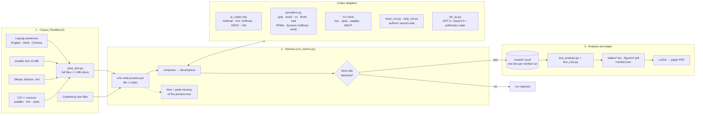

# Counting the Whole Cost of Lossless Text Compression

Code, logs and LaTeX source for the paper *Counting the Whole Cost of Lossless Text Compression: A Multilingual
Benchmark from Huffman Coding to Language Models on a Consumer Laptop*.

**Author:** Nishant Sharma

The study runs 20 lossless compressors on English, Hindi and Chinese text, encyclopaedic markup, literature, XML and
source code. They range from order-0 Huffman coding and the Enhanced Extended Huffman Coding (EEHC) scheme, through
gzip, xz, zstd, Brotli, bsc, PPMd, zpaq, paq8px and adaptive neural compressors (TRACE, DZip, NNCP), to pretrained
language models (GPT-2, Qwen2.5-0.5B, Qwen2.5-1.5B) driving an arithmetic coder. Everything ran on one laptop
(Intel Core i5-13420H, 16 GB RAM, NVIDIA RTX 4050 with 6 GB). A result counts only if the decoded file is
byte-for-byte identical to the input.

The compiled paper is in
[`research/papers/p1_text/Paper1_Text_Lossless_Compression_Huffman_to_Language_Models.pdf`](research/papers/p1_text/Paper1_Text_Lossless_Compression_Huffman_to_Language_Models.pdf).

## Main results

| | |
|---|---|
| Best result (1 MB Hindi slice) | Qwen2.5-1.5B + arithmetic coding, 0.770 bits per byte, 18% below paq8px |
| Cost of the model | its 0.99–3.09 GB of weights are paid back only after 5.9–20.9 GB of text against xz |
| Multilingual gap | most of the gap between English and Hindi or Chinese comes from the tokeniser, not the model |
| EEHC | 1.70 bits per byte on its payload, 7.70 once the codebook is counted; worse than plain Huffman on 14 of 15 files |

## Architecture



**How a measurement is made.**

1. **Isolation.** `run_bench.py` starts every codec in its own process. It polls the resident memory of that
   process and all its children, and records wall time.
2. **Verification.** The packed file is decompressed in a second process. The result is accepted only if the
   SHA-256 of the restored file equals that of the original.
3. **Logging.** Each accepted run is written as one JSON line, with the packed size and the times of both
   directions. Codecs that can also report payload and side information (codebook, header, stored model) add
   those fields.
4. **Resuming.** Rows already in a results file are skipped, so long runs can be stopped and resumed.
5. **Memory.** Memory-heavy codecs (paq8px, NNCP, TRACE, DZip and the language models) take a file lock, so only
   one of them runs at a time on a 16 GB machine.

**Three cost levels.** For an input of *N* bytes, a method produces a payload *P* (the coded symbols) and side
information *S* that the decoder reads from the file. It may also rely on pretrained knowledge *K* that is not in
the file (language-model weights, Brotli's built-in dictionary). The analysis reports three rates in bits per byte:

| Rate | Formula | Meaning |
|---|---|---|
| *r*<sub>P</sub> | 8*P* / *N* | what most papers report |
| *r*<sub>F</sub> | 8(*P* + *S*) / *N* | the self-contained file you would actually store |
| *r*<sub>K</sub>(*N*) | 8(*P* + *S* + *K*) / *N* | also pays once for the pretrained knowledge |

The input size at which a pretrained model breaks even with a classical compressor follows from *r*<sub>K</sub>.

**Language-model coder (`llm_ac.py`).** The text is cut at line breaks into pieces of at most 1,023 tokens, and
each piece is coded from a fresh context. The model's next-token distribution is quantised on the GPU to integer
frequencies and drives an exact 32-bit arithmetic coder. Encoder and decoder run the identical incremental
computation, which is what makes decoding exact. A piece that is not valid UTF-8, or whose tokens do not decode back
to the same bytes, is stored raw (zstd) and counted.

**Tokeniser decomposition.** The payload rate is split as
*r*<sub>P</sub> = (tokens / byte) × (bits / token). This separates the tokeniser's share of the multilingual gap
from the model's.

## Repository layout

```
js/
  eehc/                 EEHC codec, plain and extended Huffman (JavaScript)
  cm/cm.js              context-mixing coder (JavaScript)
research/
  bench/
    run_bench.py        harness: compress, decompress, verify, log
    js_codec.mjs        adapter for the JavaScript coders
    pycodecs.py         gzip, bzip2, xz, Brotli, zstd, PPMd, dynamic Huffman, rANS
    llm_ac.py           pretrained language model + arithmetic coding
    trace_run.py        TRACE, split into separate compress / decompress runs
    dzip_run.py         DZip and its bootstrap-only (DeepZip-style) variant
    prep_text.py        builds TextBench from the downloaded corpora
    run_text.sh         every benchmark run behind the paper
  analysis/
    common.py           loading, plotting and LaTeX helpers
    text_analysis.py    tables, figures and numbers for the paper
    text_cost.py        cost levels, break-even input sizes, tokeniser split, figures
  results/              raw JSONL logs used in the paper
  papers/
    common/             shared LaTeX preamble and bibliography
    p1_text/            paper source, generated tables and figures, compiled PDF
```

## How to use

### 1. Requirements

* Python 3.10 and `pip install -r requirements.txt` (a CUDA build of PyTorch for the language models and TRACE).
* Node.js 18 or newer (for the JavaScript coders).
* A C++ compiler (for example WinLibs GCC on Windows) to build bsc, zpaq and paq8px.
* A LaTeX distribution with `latexmk` (MiKTeX or TeX Live) to build the paper.

### 2. Third-party compressors

Put them in `research/third_party/` (this folder is not committed). The paths below are the ones the harness uses.

| Folder | Source | Build output used |
|---|---|---|
| `libbsc` | https://github.com/IlyaGrebnov/libbsc | `build/bsc.exe` |
| `zpaq` | https://github.com/zpaq/zpaq | `zpaq.exe` |
| `paq8px` | https://github.com/hxim/paq8px | `build_mingw/paq8px.exe` |
| `nncp` | https://bellard.org/nncp/ (Windows build, 2024-06-05) | `nncp.exe` |
| `A-Fast-Transformer-based-General-Purpose-LosslessCompressor` | https://github.com/mynotwo/A-Fast-Transformer-based-General-Purpose-LosslessCompressor | used as Python source (TRACE) |
| `Dzip-torch` | https://github.com/mohit1997/Dzip-torch | used as Python source (DZip) |

The changes needed to run TRACE and DZip on current PyTorch and NumPy are applied by the wrappers at run time. They
are listed at the top of `trace_run.py` and `dzip_run.py`, and none of them changes the coding itself.

### 3. Build the corpus

Download into `research/data/text/`:

* the Leipzig Corpora Collection 100K-sentence Wikipedia samples for English, Hindi and Chinese, into
  `leipzig_eng/`, `leipzig_hin/` and `leipzig_zho/`;
* `enwik8`, into `enwik8/`;
* the Canterbury corpus text files, into `canterbury/`.

Download the Silesia corpus into any folder (it needs `silesia/dickens` and `silesia/xml`), then run:

```bash
python -I research/bench/prep_text.py PATH/TO/FOLDER/HOLDING/silesia
```

This writes the full files to `research/data/text/bench/` and the first ~1 MB of each, cut at a line break, to
`research/data/text/slices/`.

### 4. Run the benchmark

To run a single codec on a single file:

```bash
python -I research/bench/run_bench.py --results mytest.jsonl --set full --codecs gzip,xz,eehc research/data/text/bench/en_sentences
```

To run everything the paper uses (this takes days for the neural compressors):

```bash
bash research/bench/run_text.sh
```

Codec names: `huffman`, `ext-huffman`, `eehc`, `dyn-huffman`, `rans0`, `gzip`, `bzip2`, `xz`, `brotli`, `zstd`,
`bsc`, `ppmd`, `zpaq`, `cm`, `paq8px`, `nncp`, `trace`, `dzip`, `dzip-bs`, `llm-gpt2`, `llm-qwen0.5b`,
`llm-qwen1.5b`.

### 5. Rebuild the tables, figures and paper

```bash
cd research/analysis
python -E -s text_analysis.py
cd ../papers/p1_text
latexmk -pdf main.tex
```

`text_analysis.py` reads `research/results/*.jsonl` and the corpus files. It writes `tables/*.tex`,
`figures/*.pdf` and `numbers.tex`, so every number in the paper comes from the logs.
